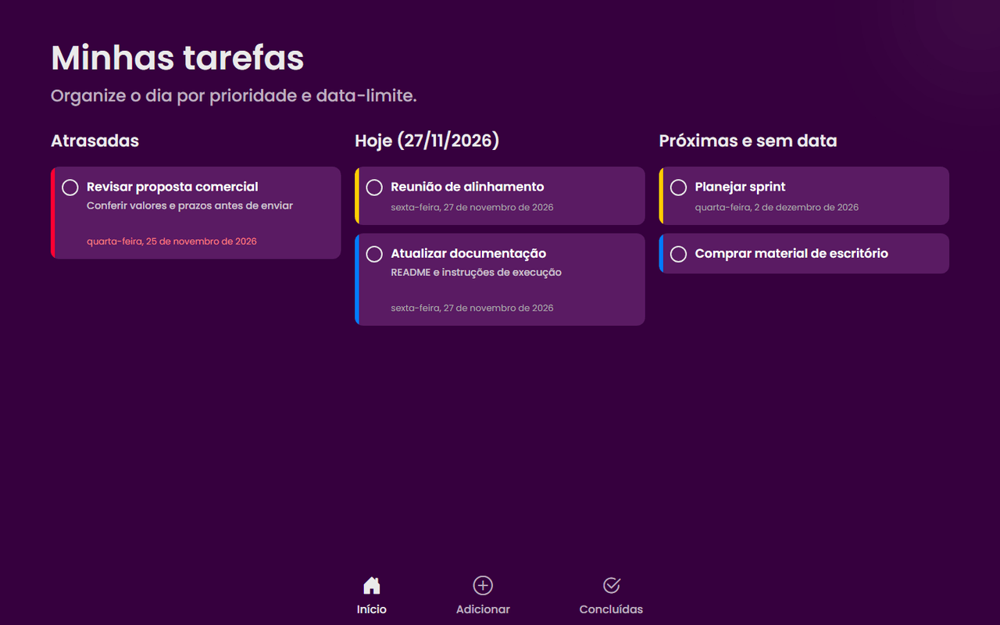
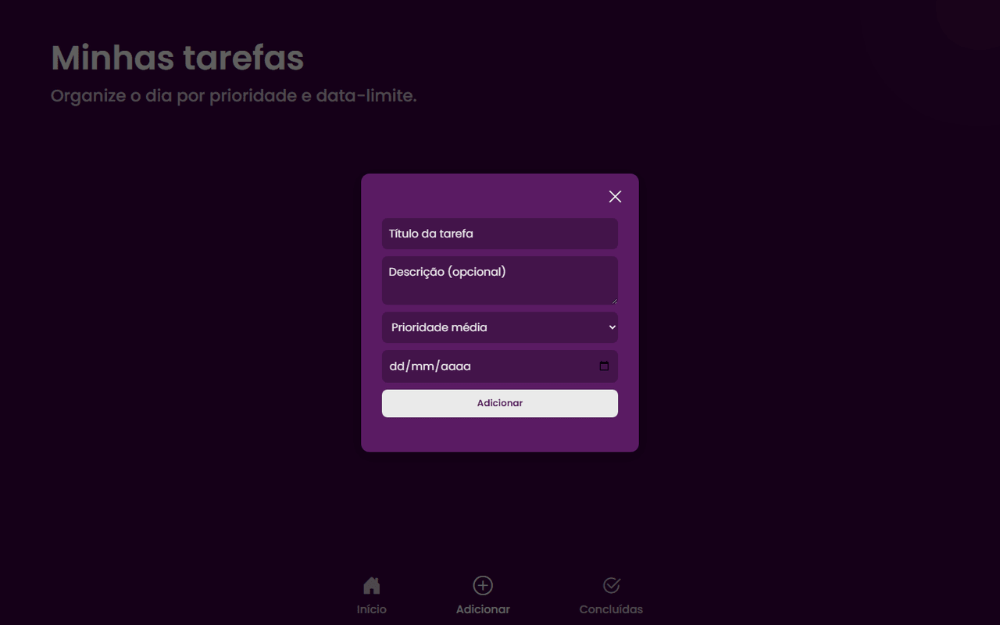
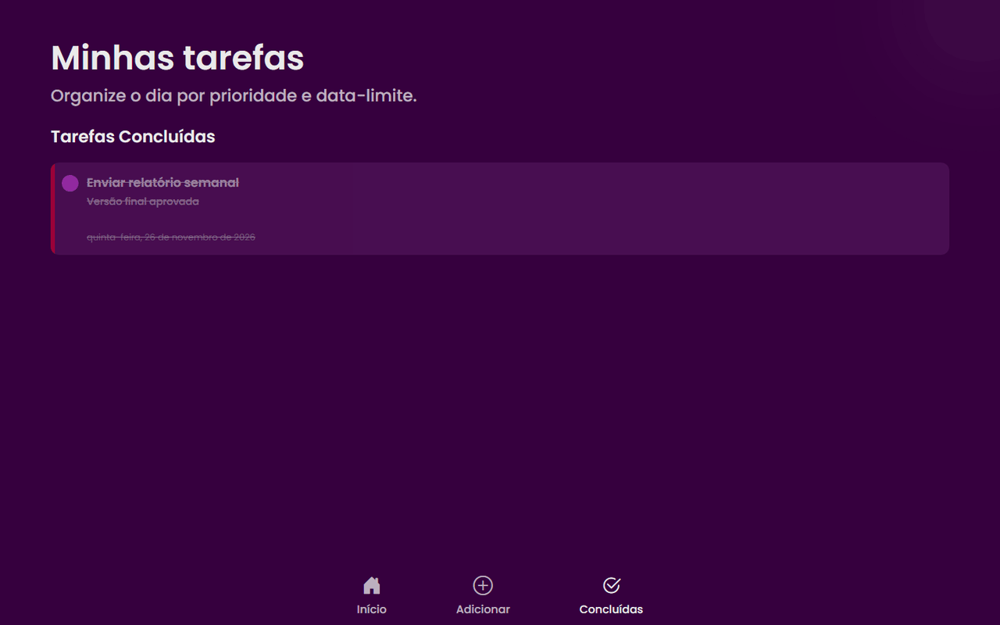

# To-Do App (Lista de Tarefas)

Aplicativo de **lista de tarefas** desenvolvido em **React** como projeto de aprendizado, com foco em organização pessoal.
Permite **adicionar, editar, concluir e excluir tarefas**, com **prioridade**, **data-limite** e separação automática entre **atrasadas**, **de hoje**, **próximas (ou sem data)** e **concluídas**.

As tarefas ficam **somente no navegador** (LocalStorage): não há servidor, cadastro nem banco de dados.

---

## 🖥️ Tecnologias Utilizadas
- **React 19** e **Vite**
- **JavaScript (ES6+)**
- **CSS3** (responsivo)
- **Bootstrap Icons**
- **LocalStorage** para salvar as tarefas no próprio navegador

---

## 📱 Funcionalidades
- Adicionar e editar tarefas com **título, descrição, prioridade e data-limite**.
- Separação automática na tela inicial:
  - **Atrasadas**: data-limite já passou.
  - **Hoje**: data-limite no dia atual.
  - **Próximas e sem data**: datas futuras (em ordem) ou tarefas sem data.
- Tela de **Concluídas**, com opção de reabrir a tarefa.
- **Persistência no LocalStorage**. Se o armazenamento estiver bloqueado (por exemplo, em navegação privada com restrições), o app continua funcionando e avisa que as tarefas não serão mantidas ao recarregar.
- Datas comparadas no **fuso horário local** do navegador.
- **Interface responsiva** (celular, tablet e desktop) e **menu fixo inferior** para navegar entre as telas.
- **Acessível por teclado**: concluir, editar e excluir funcionam com Tab/Enter, o formulário fecha com Esc e os campos têm rótulos para leitores de tela.

---

## 📷 Screenshots

### **Tela Inicial (Atrasadas, Hoje e Próximas)**


### **Adicionar / Editar Tarefas**


### **Tarefas Concluídas**


> Capturas da aplicação em execução, com tarefas de exemplo.

---

## 🚀 Como Rodar o Projeto

Pré-requisito: **Node.js 20 ou superior**.

1. Clone o repositório:
```bash
git clone https://github.com/GuiFurlaneti/todo-app.git
```

2. Entre na pasta do projeto:
```bash
cd todo-app
```

3. Instale as dependências:
```bash
npm install
```

4. Execute em modo de desenvolvimento:
```bash
npm run dev
```

O app rodará em http://localhost:5173.

### Outros comandos
| Comando | O que faz |
|---|---|
| `npm run lint` | Verifica o código com ESLint |
| `npm run build` | Gera a versão de produção em `dist/` |
| `npm run preview` | Serve a versão de produção localmente em http://localhost:4173/todo-app/ |

---

## 🌐 Publicação

O build de produção usa o caminho base **`/todo-app/`** (configurado em `vite.config.js`), pensado para o GitHub Pages no endereço `https://guifurlaneti.github.io/todo-app/`.

A publicação automática **ainda não está configurada**. Para publicar, basta enviar o conteúdo de `dist/` para o GitHub Pages (por exemplo, com um workflow oficial de Pages via GitHub Actions). Se o endereço mudar, ajuste o `base` em `vite.config.js`.

---

## 📄 Licença
Este projeto está sob a licença MIT - sinta-se à vontade para utilizar e modificar.

## 👨‍💻 Autor
**Guilherme Furlaneti** -
_Desenvolvedor Full Stack_

**Contatos**
* 📧 Email: gfurlaneti@gmail.com
* 📱 Telefone: (11) 98768-8538
* 💼 LinkedIn: https://linkedin.com/in/gui-furlaneti
* 💻 GitHub: https://github.com/GuiFurlaneti
